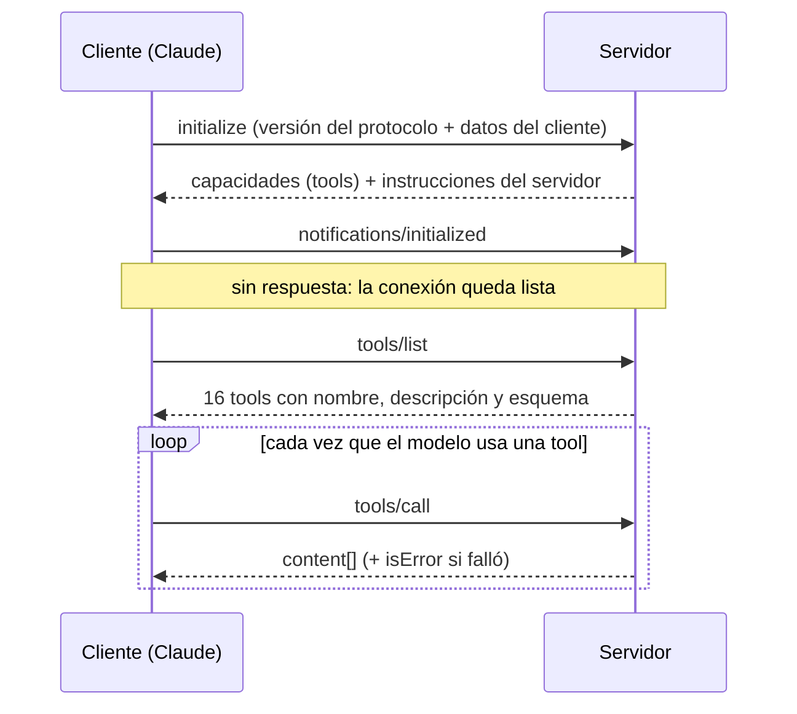

# Manual de mcp-datos-argentina

**Preguntale a tu IA por la Argentina, con datos oficiales.**

`mcp-datos-argentina` es un servidor MCP: un programa chico que conectás a Claude (o a otro asistente compatible) para que consulte en tiempo real el BCRA, el dólar, la inflación, el riesgo país, los plazos fijos, los feriados, la normalización de direcciones de Georef y miles de series oficiales del INDEC. No necesita claves ni registros.

> **Vos:** ¿Conviene un plazo fijo de un millón a 30 días o pierdo contra la inflación?
>
> _→ `plazos_fijos { "monto": 1000000, "dias": 30 }`_
>
> **Claude:** La mejor tasa publicada es la de Banco de Comercio: TNA 24,25%, TEA 27,14%. Tu millón se convierte en $1.019.931,51 a los 30 días. Contra la última inflación mensual (1,9% en septiembre 2026) le ganás apenas un 0,12% real por mes.
>
> <sub>Respuesta real del 9 de noviembre de 2026. Las tasas cambian: siempre confirmalas con el banco.</sub>

## Contenido

**Entender**
1. [Qué es MCP](#qué-es-mcp)
2. [El recorrido de una pregunta](#el-recorrido-de-una-pregunta)
3. [El protocolo por dentro](#el-protocolo-por-dentro)

**Usar**
4. [Instalación](#instalación)
5. [Formas de consultar](#formas-de-consultar)
6. [Preguntas de ejemplo](#preguntas-de-ejemplo)
7. [Leer las respuestas](#leer-las-respuestas)
8. [Referencia de tools](#referencia-de-tools)

**Antes de confiar**
9. [Límites y uso responsable](#límites-y-uso-responsable)
10. [Solución de problemas](#solución-de-problemas)

---

## Qué es MCP

El **Model Context Protocol** es un estándar abierto para conectar asistentes de IA con herramientas y datos externos. Funciona como un enchufe universal: si una aplicación de IA habla MCP y un servidor habla MCP, se conectan sin código especial para cada combinación.

En una conexión MCP participan tres piezas:

| Rol | Qué es | En este caso |
|---|---|---|
| **Host** | La aplicación que usás. Es donde escribís y donde vive el modelo. | Claude Desktop, Claude Code u otra app compatible |
| **Cliente** | El conector que el host crea por cada servidor. Lo arranca, negocia la conexión y le pasa los pedidos. | Lo maneja la app, no tenés que hacer nada |
| **Servidor** | El programa que declara herramientas y las ejecuta. | `mcp-datos-argentina` |

Un servidor MCP puede ofrecer tres tipos de cosas: **tools** (acciones que el modelo decide ejecutar), **resources** (documentos para leer) y **prompts** (plantillas). Este servidor ofrece solamente **tools**: 16 consultas de solo lectura. Ninguna modifica nada ni manda datos tuyos a ningún lado, salvo los parámetros de la consulta a la API correspondiente.

## El recorrido de una pregunta

Esto pasa cuando preguntás "¿a cuánto está el blue?" con el servidor conectado:

1. **El host le muestra al modelo las tools disponibles.** Al arrancar, el cliente pidió la lista (`tools/list`). El modelo ve el nombre, la descripción y los parámetros de cada una.
2. **El modelo decide usar una tool.** Lee tu pregunta, elige `cotizaciones_dolar` y arma los argumentos: `{ "casa": "blue" }`. Según la app, puede pedirte permiso antes de ejecutarla.
3. **El cliente le manda el pedido al servidor.** Un mensaje JSON-RPC `tools/call` viaja por la entrada estándar del proceso.
4. **El servidor consulta la fuente.** Valida los argumentos, consulta dolarapi.com (o usa la caché si la consulta es reciente) y arma la respuesta.
5. **El resultado vuelve al modelo.** Una línea de resumen más el JSON completo. El modelo lo lee y te responde en lenguaje natural, citando los números.

> [!TIP]
> La IA no inventa el dato: lo lee de la respuesta de la tool. Si querés comprobarlo, la mayoría de las apps te deja expandir la llamada y ver el resultado crudo.

## El protocolo por dentro

Esta sección es para quien quiera integrar el servidor por su cuenta o entender qué viaja por el cable. Si solo vas a usarlo desde Claude, saltá a [Instalación](#instalación).

### Transporte: stdio

El cliente arranca el servidor como un proceso hijo (`node dist/index.js`) y se comunican por la entrada y salida estándar. Cada mensaje es un objeto JSON en **una sola línea**, terminado en salto de línea. Por eso el servidor nunca escribe nada más en stdout: sus logs van a stderr.

### Formato: JSON-RPC 2.0

- Un **pedido** lleva `id`, `method` y `params`.
- Una **respuesta** repite el `id` y trae `result` o `error`.
- Una **notificación** no lleva `id` y no espera respuesta.

### Ciclo de vida



### Mensajes reales

Capturados de una sesión con este servidor. Se muestran con sangría para leerlos; en el cable viaja cada uno en una sola línea.

**1 · `initialize`.** El cliente dice qué versión del protocolo habla; el servidor responde con su nombre, versión, capacidades e instrucciones para el modelo.

```json
{"jsonrpc":"2.0","id":1,"method":"initialize","params":{"protocolVersion":"2025-06-18","capabilities":{},"clientInfo":{"name":"manual-demo","version":"1.0"}}}
```

```json
{
  "result": {
    "protocolVersion": "2025-06-18",
    "capabilities": { "tools": { "listChanged": true } },
    "serverInfo": { "name": "mcp-datos-argentina", "version": "0.3.0" },
    "instructions": "Datos públicos de Argentina en tiempo real: dólar (oficial, blue, MEP, CCL), riesgo país, plazos fijos por banco, …"
  },
  "jsonrpc": "2.0",
  "id": 1
}
```

**2 · `notifications/initialized`.** Una notificación (sin `id`): el cliente avisa que está listo. El servidor no contesta.

```json
{"jsonrpc":"2.0","method":"notifications/initialized"}
```

**3 · `tools/list`.** El catálogo. Cada tool trae un JSON Schema de sus parámetros: es lo que el modelo lee para saber cómo llamarla. La [referencia](#referencia-de-tools) de este manual se genera con esta misma respuesta.

```json
{"jsonrpc":"2.0","id":2,"method":"tools/list"}
```

**4 · `tools/call`.** El pedido que se repite en cada uso. La respuesta trae `content`, una lista de bloques; este servidor siempre devuelve un bloque de texto con el resumen y el JSON.

```json
{"jsonrpc":"2.0","id":3,"method":"tools/call","params":{"name":"cotizaciones_dolar","arguments":{"casa":"blue"}}}
```

```json
{
  "result": {
    "content": [
      {
        "type": "text",
        "text": "Blue: compra 1535 / venta 1555\n\n[\n  {\n    \"moneda\": \"USD\",\n    \"casa\": \"blue\",\n    \"nombre\": \"Blue\",\n    \"compra\": 1535,\n    \"venta\": 1555,\n    \"fechaActualizacion\": \"2026-11-09T20:58:00.000Z\"\n  }\n]"
      }
    ]
  },
  "jsonrpc": "2.0",
  "id": 3
}
```

**5 · Error de una tool.** No es un error del protocolo: la respuesta es normal, pero con `isError: true`. Así el modelo lee el motivo y puede corregir el pedido.

```json
{"jsonrpc":"2.0","id":4,"method":"tools/call","params":{"name":"consultar_deudor","arguments":{"cuit":"20-12345678-0"}}}
```

```json
{
  "result": {
    "content": [
      { "type": "text", "text": "El CUIT/CUIL \"20-12345678-0\" no es válido (dígito verificador incorrecto o formato inválido)." }
    ],
    "isError": true
  },
  "jsonrpc": "2.0",
  "id": 4
}
```

## Instalación

Necesitás **Node.js 20 o superior** (comprobalo con `node -v`) y git.

```bash
git clone https://github.com/Gonza28fq/mcp-datos-argentina.git
cd mcp-datos-argentina
npm install
npm run build
```

Eso genera `dist/index.js`, el archivo que va a ejecutar tu aplicación. Anotá su ruta completa.

### Claude Code

Con `--scope user` queda disponible en todos tus proyectos; sin él, solo en la carpeta actual.

```bash
claude mcp add --scope user datos-argentina -- node /ruta/completa/mcp-datos-argentina/dist/index.js
claude mcp list   # verificá que conecta
```

Dentro de una sesión, `/mcp` muestra el estado y las 16 tools.

### Claude Desktop

Editá el archivo de configuración (en la app: **Configuración → Desarrollador → Editar configuración**):

| Sistema | Archivo |
|---|---|
| Windows | `%APPDATA%\Claude\claude_desktop_config.json` |
| macOS | `~/Library/Application Support/Claude/claude_desktop_config.json` |

Agregá el servidor dentro de `mcpServers` (si ya tenés otros, sumalo a la lista):

```json
{
  "mcpServers": {
    "datos-argentina": {
      "command": "node",
      "args": ["C:/ruta/completa/mcp-datos-argentina/dist/index.js"]
    }
  }
}
```

Cerrá Claude Desktop por completo y volvé a abrirlo.

### Otros clientes

Cualquier aplicación compatible con MCP por stdio sirve. Lo que siempre vas a configurar:

| Campo | Valor |
|---|---|
| Transporte | `stdio` |
| Comando | `node` |
| Argumentos | `/ruta/completa/dist/index.js` |
| Variables de entorno | ninguna |

### Con npx (próximamente)

Cuando el paquete esté publicado en npm no vas a necesitar clonar ni compilar:

```bash
claude mcp add --scope user datos-argentina -- npx -y mcp-datos-argentina
```

> [!NOTE]
> Todavía no está publicado en npm: hasta entonces usá la instalación desde el repositorio.

## Formas de consultar

### 1 · Lenguaje natural

La forma normal: con el servidor conectado, preguntale a Claude como a cualquier persona. El modelo elige la tool, la ejecuta y te responde.

Si querés una tool en particular, nombrala: _"usá `consultar_series` con la serie `148.3_INIVELNAL_DICI_M_26` y transformación `variacion_interanual_pct`"_.

### 2 · MCP Inspector

La herramienta oficial para probar servidores MCP sin un asistente de por medio. Abre una interfaz web local donde ves las tools, completás los parámetros en un formulario y ves la respuesta cruda.

```bash
npx @modelcontextprotocol/inspector node dist/index.js
# o con el script incluido
npm run inspector
```

### 3 · Desde tu código

Con el SDK oficial podés usar el servidor desde tu propio programa, sin modelo de por medio (es lo que hace `npm run smoke`):

```js
// npm install @modelcontextprotocol/sdk
import { Client } from "@modelcontextprotocol/sdk/client/index.js";
import { StdioClientTransport } from "@modelcontextprotocol/sdk/client/stdio.js";

const client = new Client({ name: "mi-app", version: "1.0.0" });
await client.connect(new StdioClientTransport({
  command: "node",
  args: ["/ruta/completa/mcp-datos-argentina/dist/index.js"],
}));

const { tools } = await client.listTools();
console.log(tools.map((t) => t.name));

const r = await client.callTool({ name: "riesgo_pais", arguments: { ultimos: 5 } });
console.log(r.content[0].text);
await client.close();
```

Hay SDKs oficiales también para Python, Java, Kotlin, C# y otros lenguajes.

### 4 · JSON-RPC crudo

Sin SDK: escribís los mensajes en la entrada del proceso, uno por línea, en el orden del [ciclo de vida](#ciclo-de-vida).

```text
node dist/index.js
{"jsonrpc":"2.0","id":1,"method":"initialize","params":{"protocolVersion":"2025-06-18","capabilities":{},"clientInfo":{"name":"terminal","version":"1.0"}}}
{"jsonrpc":"2.0","method":"notifications/initialized"}
{"jsonrpc":"2.0","id":2,"method":"tools/call","params":{"name":"feriados","arguments":{"solo_proximos":true}}}
```

Después de cada pedido con `id`, el servidor responde con una línea de JSON con el mismo `id`. Para salir, cerrá la entrada (Ctrl+D, o Ctrl+Z y Enter en Windows).

## Preguntas de ejemplo

No hace falta nombrar la tool: el modelo elige cuál usar. Cuanto más específica la pregunta (fechas, montos, provincia), mejor la respuesta.

| Tema | Preguntas |
|---|---|
| **Dólar y BCRA** | ¿A cuánto está el blue y el MEP? · ¿Cuál fue la cotización oficial del euro la semana pasada? · ¿Cómo evolucionaron las reservas en el último mes? · ¿Cuánto vale hoy la UVA? |
| **Inflación** | ¿Cuánta inflación acumulada hubo en 2025? · ¿Cuánto son hoy $100.000 de enero de 2023? · ¿Cuál fue la inflación interanual del IPC alimentos? |
| **Inversiones** | ¿Qué banco paga más por un plazo fijo a 90 días? · Si pongo $500.000 a 30 días sin ser cliente, ¿cuánto gano? · ¿Cómo viene el riesgo país en el último mes? |
| **Direcciones** | Normalizá "av rivadavia 1050, caba" y dame las coordenadas · ¿En qué municipio cae -29.41, -66.85? · Listá los municipios de La Rioja |
| **Estadísticas** | ¿Cuánto es el salario mínimo vital y móvil? · Buscá la serie del EMAE y mostrame la variación interanual · Compará el IPC con el salario mínimo en los últimos 12 meses |
| **Créditos y calendario** | ¿Cómo está el CUIT 30-54668997-9 en la Central de Deudores? · ¿Cuándo es el próximo feriado? |

## Leer las respuestas

Todas las tools devuelven un único bloque de texto con dos partes, separadas por una línea en blanco:

1. **Resumen en castellano**: una o dos líneas con lo importante, listas para que el modelo las use.
2. **JSON completo**: todos los datos estructurados, para cálculos o gráficos posteriores.

| Dato | Formato |
|---|---|
| Fechas | `YYYY-MM-DD`; meses como `YYYY-MM` |
| Porcentajes | Ya multiplicados por 100: `24.25` significa 24,25% |
| Riesgo país | Puntos básicos (pb): 939 pb = 9,39 puntos sobre los bonos del Tesoro de EE.UU. |
| TNA / TEA | Tasa nominal anual / efectiva anual, que asume renovar al mismo plazo |
| Situación crediticia | 1 normal · 2 seguimiento especial · 3 con problemas · 4 alto riesgo · 5 irrecuperable · 6 irrecuperable por disposición técnica |
| Orden de las series | De la más antigua a la más reciente, salvo las del BCRA (la más reciente primero) |

Cuando algo falla, la respuesta llega con `isError: true` y un mensaje que explica la causa (CUIT inválido, serie inexistente, la API no respondió). La conversación sigue: el modelo puede corregir el pedido o explicarte qué pasó.

## Referencia de tools

<!-- REFERENCIA:INICIO (generado por scripts/gen-manual.mjs, no editar a mano) -->

_16 tools. Generado desde `tools/list`._

### Dólar y BCRA

#### `cotizaciones_dolar` · Cotizaciones del dólar

Cotizaciones actuales del dólar en Argentina: oficial, blue, bolsa (MEP), contado con liquidación (CCL), mayorista, cripto y tarjeta. Fuente: dolarapi.com.

| Parámetro | Tipo | Por defecto | Descripción |
|---|---|---|---|
| `casa` | `oficial` · `blue` · `bolsa` · `contadoconliqui` · `mayorista` · `cripto` · `tarjeta` | — | Tipo de dólar. Si se omite, devuelve todos. |

> **Preguntale así:** ¿A cuánto está el dólar blue?

#### `cotizacion_bcra` · Cotización oficial BCRA

Tipo de cambio oficial publicado por el BCRA (Comunicación A 3500 / estadísticas cambiarias) para una moneda (USD, EUR, BRL, etc.). Sin fechas devuelve la última publicación de todas las monedas.

| Parámetro | Tipo | Por defecto | Descripción |
|---|---|---|---|
| `moneda` | texto (3 caracteres) | — | Código ISO de la moneda, ej. USD, EUR, BRL. Si se omite, devuelve todas. |
| `desde` | texto (YYYY-MM-DD) | — | Fecha inicial YYYY-MM-DD (requiere moneda). |
| `hasta` | texto (YYYY-MM-DD) | — | Fecha final YYYY-MM-DD (por defecto hoy). |

> **Preguntale así:** ¿Cuál fue la cotización oficial del real brasileño la última semana?

#### `buscar_variables_bcra` · Buscar variables del BCRA

Busca entre las ~1600 variables monetarias del BCRA (reservas, base monetaria, tasas BADLAR/TAMAR, CER, UVA, ICL, inflación, bandas cambiarias, etc.) y devuelve su id y último valor. Usar el id con serie_variable_bcra.

| Parámetro | Tipo | Por defecto | Descripción |
|---|---|---|---|
| `texto` | texto | — | Texto a buscar en la descripción (sin distinguir mayúsculas ni acentos). Si se omite, devuelve las 'Principales Variables'. |
| `limite` | entero (mín 1, máx 100) | `25` |  |

> **Preguntale así:** ¿Qué variables del BCRA hay sobre tasas de interés?

#### `serie_variable_bcra` · Serie histórica de variable BCRA

Devuelve los valores de una variable monetaria del BCRA por id (ej. 1 = Reservas, 4 = dólar minorista, 7 = BADLAR, 27 = inflación mensual, 30 = CER, 31 = UVA, 40 = ICL). Usar buscar_variables_bcra para encontrar ids.

| Parámetro | Tipo | Por defecto | Descripción |
|---|---|---|---|
| `id` **(obligatorio)** | entero (máx 9007199254740991) | — | idVariable del BCRA. |
| `desde` | texto (YYYY-MM-DD) | — |  |
| `hasta` | texto (YYYY-MM-DD) | — |  |
| `limite` | entero (mín 1, máx 1000) | `30` | Cantidad máxima de valores (los más recientes primero). |

> **Preguntale así:** ¿Cómo evolucionaron las reservas internacionales en el último mes?

### Mercado

#### `riesgo_pais` · Riesgo país

Riesgo país de Argentina (EMBI, en puntos básicos): último valor, variación diaria y en el período, mínimo y máximo, y la serie. Por defecto los últimos 30 días hábiles; historia disponible desde 1999.

| Parámetro | Tipo | Por defecto | Descripción |
|---|---|---|---|
| `desde` | texto (YYYY-MM-DD) | — |  |
| `hasta` | texto (YYYY-MM-DD) | — |  |
| `ultimos` | entero (mín 1, máx 2000) | `30` | Si no hay 'desde', cantidad de días hábiles más recientes. |

> **Preguntale así:** ¿Cómo viene el riesgo país en el último mes?

#### `plazos_fijos` · Plazos fijos por banco

Compara las tasas de plazo fijo en pesos de bancos y billeteras (TNA, TEA, rendimiento mensual) ordenadas de mayor a menor. Con monto calcula el interés de cada uno, y compara el rendimiento contra la última inflación mensual (tasa real).

| Parámetro | Tipo | Por defecto | Descripción |
|---|---|---|---|
| `dias` | entero (mín 30, máx 1095) | `30` | Plazo en días (mínimo legal 30). |
| `monto` | número | — | Monto a invertir en pesos, para calcular el interés. |
| `cliente` | sí/no | `true` | true = tasas para clientes del banco; false = solo bancos que aceptan no clientes. |
| `limite` | entero (mín 1, máx 50) | `10` |  |

> **Preguntale así:** ¿Qué banco paga más por $1.000.000 a 90 días?

### Inflación

#### `inflacion` · Inflación mensual (IPC)

Inflación mensual del IPC (INDEC) y acumulada para un rango de meses. Sin rango devuelve los últimos 12 meses publicados.

| Parámetro | Tipo | Por defecto | Descripción |
|---|---|---|---|
| `desde` | texto (YYYY-MM) | — | Mes inicial YYYY-MM. |
| `hasta` | texto (YYYY-MM) | — | Mes final YYYY-MM. |

> **Preguntale así:** ¿Cuánta inflación acumulada hubo entre enero y junio de 2026?

#### `ajustar_por_inflacion` · Ajustar monto por inflación

Convierte un monto en pesos de un mes a pesos de otro mes usando el IPC (ej. '¿cuánto son hoy $100.000 de enero 2023?'). También funciona hacia atrás.

| Parámetro | Tipo | Por defecto | Descripción |
|---|---|---|---|
| `monto` **(obligatorio)** | número | — | Monto en pesos. |
| `desde` **(obligatorio)** | texto (YYYY-MM) | — | Mes en que está expresado el monto (YYYY-MM). |
| `hasta` | texto (YYYY-MM) | — | Mes destino (YYYY-MM). Por defecto el último mes publicado. |

> **Preguntale así:** ¿Cuánto son hoy $100.000 de enero de 2023?

### Créditos

#### `consultar_deudor` · Central de Deudores BCRA

Consulta la situación crediticia de un CUIT/CUIL en la Central de Deudores del BCRA (deudas por entidad, situación 1-6) y cheques rechazados. Montos tal como los informa el BCRA (unidad no documentada públicamente). Información pública del BCRA.

| Parámetro | Tipo | Por defecto | Descripción |
|---|---|---|---|
| `cuit` **(obligatorio)** | texto | — | CUIT/CUIL, con o sin guiones. |
| `historico` | sí/no | `false` | Si es true, incluye los últimos 24 meses en lugar de solo el último período. |

> **Preguntale así:** ¿Cómo está el CUIT 30-54668997-9 en la Central de Deudores?

### Calendario

#### `feriados` · Feriados nacionales

Feriados nacionales de Argentina (inamovibles, trasladables y días no laborables con fines turísticos) para un año. Con solo_proximos=true devuelve los que faltan a partir de hoy.

| Parámetro | Tipo | Por defecto | Descripción |
|---|---|---|---|
| `anio` | entero (mín 2016, máx 2100) | — | Año (por defecto el actual). |
| `solo_proximos` | sí/no | `false` |  |

> **Preguntale así:** ¿Cuándo es el próximo feriado?

### Geografía (Georef)

#### `normalizar_direccion` · Normalizar dirección

Normaliza y geolocaliza una dirección argentina (ej. 'Av. Rivadavia 1050', 'Corrientes 1234 piso 3') usando Georef. Devuelve nomenclatura oficial, provincia, departamento, localidad y coordenadas. Si no hay coincidencia exacta con altura, sugiere las calles con ese nombre.

| Parámetro | Tipo | Por defecto | Descripción |
|---|---|---|---|
| `direccion` **(obligatorio)** | texto | — | Dirección: calle y altura. También acepta intersecciones ('X y Y'). |
| `provincia` | texto | — | Nombre o id de provincia para acotar (ej. 'La Rioja', 'caba', '46'). |
| `departamento` | texto | — | Nombre o id de departamento/partido/comuna. |
| `localidad` | texto | — | Nombre o id de localidad censal. |
| `max` | entero (mín 1, máx 20) | `5` |  |

> **Preguntale así:** Normalizá 'corrientes 1234, caba' y dame las coordenadas

#### `normalizar_direcciones_lote` · Normalizar direcciones en lote

Normaliza y geolocaliza hasta 500 direcciones en una sola llamada (ideal para limpiar padrones o cargas masivas de domicilios). Devuelve, para cada entrada, si se encontró y su versión normalizada con coordenadas.

| Parámetro | Tipo | Por defecto | Descripción |
|---|---|---|---|
| `direcciones` **(obligatorio)** | lista de objetos (`direccion`, `provincia`, `departamento`, `localidad`) | — |  |

> **Preguntale así:** Normalizá esta lista de domicilios y decime cuáles no se encontraron

#### `buscar_lugar` · Buscar provincia, municipio, localidad o calle

Busca unidades territoriales oficiales de Argentina (provincias, departamentos, municipios, localidades o calles) por nombre, con su id INDEC y centroide. Sin nombre, lista todas las de ese tipo (ej. todos los municipios de una provincia).

| Parámetro | Tipo | Por defecto | Descripción |
|---|---|---|---|
| `tipo` **(obligatorio)** | `provincias` · `departamentos` · `municipios` · `localidades` · `calles` | — |  |
| `nombre` | texto | — | Nombre a buscar (tolera errores de tipeo y falta de acentos). |
| `provincia` | texto | — | Provincia para acotar (no aplica a tipo=provincias). |
| `max` | entero (mín 1, máx 500) | `20` |  |

> **Preguntale así:** Listá los municipios de la provincia de Córdoba

#### `ubicacion_por_coordenadas` · ¿Dónde queda esta coordenada?

Dado un punto (lat, lon), devuelve la provincia, departamento y municipio argentinos que lo contienen.

| Parámetro | Tipo | Por defecto | Descripción |
|---|---|---|---|
| `lat` **(obligatorio)** | número (mín -90, máx 90) | — |  |
| `lon` **(obligatorio)** | número (mín -180, máx 180) | — |  |

> **Preguntale así:** ¿En qué provincia y municipio cae el punto -31.42, -64.18?

### Series oficiales

#### `buscar_series` · Buscar series de tiempo oficiales

Busca entre las series oficiales de datos.gob.ar (INDEC y ministerios): IPC por rubro y región, salarios, salario mínimo, EMAE/actividad, desempleo, canasta básica, exportaciones, recaudación, etc. Devuelve ids para usar en consultar_series.

| Parámetro | Tipo | Por defecto | Descripción |
|---|---|---|---|
| `texto` **(obligatorio)** | texto | — | Términos de búsqueda, ej. 'salario minimo', 'ipc alimentos', 'emae', 'canasta basica'. |
| `limite` | entero (mín 1, máx 50) | `10` |  |

> **Preguntale así:** Buscá series sobre desempleo

#### `consultar_series` · Consultar series de tiempo

Devuelve valores de una o más series oficiales (ids de buscar_series), con transformaciones (variación, variación interanual en %) y cambio de frecuencia (ej. mensual → anual promedio). Sin fechas devuelve los últimos N valores.

| Parámetro | Tipo | Por defecto | Descripción |
|---|---|---|---|
| `ids` **(obligatorio)** | lista de string | — | Ids de series, ej. ['148.3_INIVELNAL_DICI_M_26']. |
| `transformacion` | `valor` · `variacion` · `variacion_pct` · `variacion_interanual` · `variacion_interanual_pct` | `"valor"` | valor original, variación contra el período anterior, o contra el mismo período del año anterior (absoluta o en %). |
| `frecuencia` | `day` · `week` · `month` · `quarter` · `semester` · `year` | — | Agregar a una frecuencia menor (ej. 'year' sobre una serie mensual). |
| `agregacion` | `avg` · `sum` · `end_of_period` · `min` · `max` | `"avg"` | Cómo agregar al cambiar la frecuencia. |
| `desde` | texto (YYYY-MM-DD) | — |  |
| `hasta` | texto (YYYY-MM-DD) | — |  |
| `ultimos` | entero (mín 1, máx 500) | `12` | Si no hay 'desde', cantidad de valores más recientes. |

> **Preguntale así:** Mostrame la inflación interanual del IPC nacional de los últimos 6 meses

<!-- REFERENCIA:FIN -->

## Límites y uso responsable

- **No es asesoramiento financiero.** Las tasas de plazo fijo se publican con demora y pueden no coincidir con la oferta del día. Confirmá con la entidad antes de invertir.
- **Fuentes oficiales y comunitarias.** BCRA, Georef y Series de Tiempo son oficiales. Dólar, inflación, feriados, riesgo país y tasas vienen de [dolarapi.com](https://dolarapi.com) y [argentinadatos.com](https://argentinadatos.com), proyectos comunitarios que recopilan datos públicos.
- **Central de Deudores.** Es información pública del BCRA, pero se refiere a personas: consultá solo CUITs con un motivo legítimo. La documentación del BCRA no aclara si los montos están en pesos o en miles de pesos; tomalos como valores relativos.
- **Direcciones del interior.** Georef no tiene numeración cargada para muchas calles fuera de los grandes centros urbanos. En esos casos la tool te ofrece las calles candidatas en lugar de coordenadas exactas.
- **Frescura de los datos.** El servidor guarda respuestas en memoria entre 2 minutos (dólar) y 24 horas (feriados, direcciones). Si reiniciás la app, la caché se vacía.
- **Agregados anuales.** Al pasar una serie a frecuencia anual, el año en curso no aparece hasta que termina.

## Solución de problemas

<details>
<summary><b>La app no muestra el servidor o sus tools</b></summary>

Comprobá que la ruta a `dist/index.js` sea absoluta y exista (¿corriste `npm run build`?). En Claude Desktop hay que cerrar la aplicación por completo y volver a abrirla después de editar la configuración. En Claude Code, `claude mcp list` muestra si el servidor conecta y `/mcp` dentro de una sesión muestra su estado.
</details>

<details>
<summary><b>En Windows falla la ruta del JSON</b></summary>

Dentro de un JSON la barra invertida se escribe doble (`C:\\ruta\\dist\\index.js`) o se reemplaza por barras normales (`C:/ruta/dist/index.js`), que Node acepta igual.
</details>

<details>
<summary><b>"node" no se reconoce como comando</b></summary>

Node no está en el PATH que ve la aplicación. Poné la ruta completa del ejecutable en `command`, por ejemplo `C:/Program Files/nodejs/node.exe`. Para encontrarla: `where node` en Windows o `which node` en macOS y Linux.
</details>

<details>
<summary><b>Una tool responde "La API no respondió a tiempo"</b></summary>

La fuente tardó más de 15 segundos (60 en los lotes de direcciones). Suele ser momentáneo: probá de nuevo en un rato. Si persiste, la API puede estar caída o haber cambiado.
</details>

<details>
<summary><b>Quiero ver qué está pasando por dentro</b></summary>

Usá el [MCP Inspector](#2--mcp-inspector) para ejecutar las tools a mano y ver los mensajes. Los logs del servidor van a stderr; Claude Desktop los guarda en su carpeta de logs como `mcp-server-datos-argentina.log`.
</details>

<details>
<summary><b>Encontré un dato raro o un error</b></summary>

Abrí un [issue](https://github.com/Gonza28fq/mcp-datos-argentina/issues) con la pregunta que hiciste, la tool que se usó y el resultado. Si podés, compará con la fuente original: varios problemas de este proyecto resultaron ser comportamientos de las APIs, documentados en el [README](../README.md#notas).
</details>

---

<sub>mcp-datos-argentina · licencia MIT · datos de BCRA, datos.gob.ar (Georef y Series de Tiempo), dolarapi.com y argentinadatos.com</sub>
